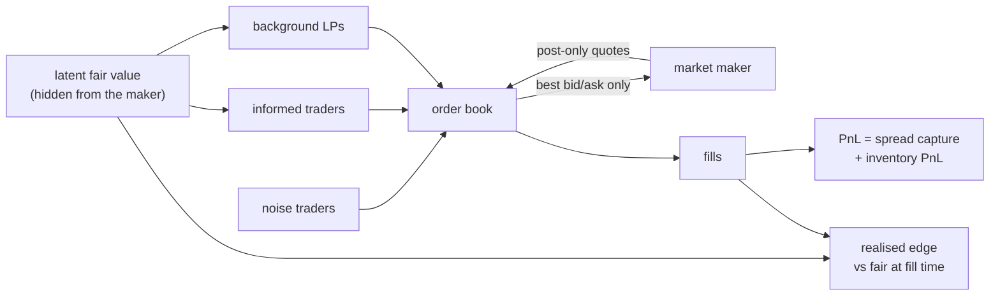

# lob-market-making

A limit order book, three market-making strategies, and an honest attempt to
measure whether any of them actually earn anything.

[](https://github.com/asp53826/lob-market-making/actions/workflows/ci.yml)


**→ [Interactive results page](https://asp53826.github.io/lob-market-making/)** —
a live order book you can watch get picked off, with sliders for spread, inventory
skew and toxic flow. Every measured table on it comes from the Python benchmark.

**→ [Order Book Royale](https://asp53826.github.io/lob-market-making/royale/)**, a
multiplayer game on this book. Up to eight traders share one live order book for
four minutes, starting with $1M each. A margin line rises behind them, and a
trader who falls below it is closed out. Empty seats go to the strategies in
`src/lob/strategies.py`, and the informed traders from `src/lob/flow.py` pick
off stale quotes, players' included. The matching engine is a JavaScript port
of `src/lob/book.py`, checked in CI against the Python book on 4,000 random
operations. Each round commits to a hashed seed before the first trade and
publishes the seed and every order at the bell, so every player's page replays
the round and checks each result to the cent.

> A market-making backtest that shows a profit is the default outcome, not a
> result. Take away informed traders and quoting is free money; take away
> post-only orders and the strategy becomes a liquidity taker while still
> reporting its losses as market-making PnL. Both of those were live in this
> repo before the measurements caught them.

## What is actually implemented

- price-time priority matching engine on integer ticks, with post-only orders,
  partial fills, cancels and market orders;
- an order flow model containing **informed traders** who see a latent fair
  value the market maker cannot, so quotes get picked off exactly when they are
  stale;
- three strategies — fixed spread, inventory-skewed, and Avellaneda-Stoikov —
  none of which can see fair value, enforced by a test;
- an exact PnL decomposition into spread capture and inventory PnL, asserted to
  sum to the total;
- realised edge per share measured against true fair value at fill time, which
  in a simulator is exact where markout decay is only a proxy;
- everything compared across paired seeds, because one seed can flip a ranking.



## Measured, not implied

12 paired seeds × 20,000 steps. Reproduce with `make bench`.

| strategy | PnL (mean±sd) | edge/share | capture | inventory | inv sd | volume | toxic | Sharpe | wins |
|---|---:|---:|---:|---:|---:|---:|---:|---:|---:|
| naive(2) | 20,853 ± 11,010 | 0.845 | 16,238 | 4,615 | **88.1** | 26,614 | 3.9% | 1.3 | 12/12 |
| skew(2) | 15,448 ± **3,129** | 0.877 | 14,609 | 838 | **12.0** | 22,873 | 3.9% | **5.7** | 12/12 |
| naive(5) | 630 ± 11,410 | 1.458 | 409 | 221 | 49.2 | 2,119 | 6.1% | 0.2 | 9/12 |
| skew(5) | 1,211 ± 2,548 | 1.802 | 811 | 399 | 12.5 | 1,926 | 6.1% | 0.7 | 8/12 |
| A-S (γ=.02) | 5,228 ± 4,492 | 0.250 | 5,316 | −88 | 17.2 | 50,119 | 5.2% | 1.6 | 10/12 |
| A-S (γ=.1) | −15,830 ± 4,668 | −0.159 | −16,356 | 526 | 10.0 | 54,006 | 6.9% | −5.7 | 0/12 |
| A-S (γ=.5) | −68,155 ± 4,147 | −1.021 | −68,189 | 35 | 7.0 | 59,248 | 9.9% | −25.6 | 0/12 |

**Ranked by PnL, the naive strategy wins. Ranked by anything that accounts for
risk, it is not close.** `naive(2)` carries 7× the inventory standard deviation
and 3.5× the PnL spread of `skew(2)` to earn 35% more, and a fifth of its PnL
is inventory drift — that is a coin flip, not an edge. The decomposition is what
makes this visible: `skew(2)` earns 14,609 of its 15,448 from quoting.

### Avellaneda–Stoikov is only as good as its `k`

The A-S spread is `γσ²(T−t) + (2/γ)·ln(1 + γ/k)`. `k` is the decay of fill
intensity with distance from mid and has to be calibrated. It is not a detail:

| γ | k | spread term | quoted | PnL | edge/share | volume |
|---:|---:|---:|---:|---:|---:|---:|
| 0.1 | 1.5 | 1.29 | 3.21 | −17,085 | −0.179 | 54,030 |
| 0.1 | 0.3 | 5.75 | 6.97 | **+4,017** | +0.765 | 12,961 |
| 0.1 | 0.05 | 21.97 | 23.17 | 834 | +5.507 | 553 |
| 0.1 | 0.01 | 47.96 | 49.15 | 6,150 | **+20.589** | **404** |
| 0.5 | 1.5 | 1.15 | 5.82 | −68,447 | −1.034 | 59,187 |
| 0.5 | 0.01 | 15.73 | 17.73 | −929 | +1.144 | 1,683 |

With `k = 1.5` the model quotes a 1.3-tick spread into a market whose own
spread is ~5, and loses money at every risk aversion. With `k = 0.3` the same
model is profitable. The published formula is not plug-and-play.

The last rows are also the cleanest demonstration of why **edge per share is
gameable on its own**: 20.6 ticks per share looks superb until you notice it was
earned on 404 shares. It only means something read next to volume and total PnL.

### Toxicity

Mean PnL, with profitable-seed count, as informed flow intensifies:

| informed rate | skew(2) | skew(5) | A-S(γ=.1) |
|---:|---:|---:|---:|
| 0.00 | 15,305 (8/8) | 782 (5/8) | −17,182 (0/8) |
| 0.25 | 12,632 (8/8) | 1,509 (6/8) | −18,454 (0/8) |
| 0.50 | 14,180 (8/8) | −823 (2/8) | −19,567 (0/8) |
| 1.00 | 11,999 (8/8) | −23 (6/8) | −22,709 (0/8) |

`skew(2)` degrades gracefully — about 20% of PnL from zero to saturation.
`skew(5)` quotes so wide it barely trades (1,926 shares against 22,873), so its
PnL is dominated by seed noise and it flips sign on the same configuration.

## Where it loses

- **The fill model is the whole ballgame.** Everything here rests on informed
  traders taking any quote on the wrong side of fair value by more than one
  tick. That is a reasonable caricature of adverse selection and it is still a
  caricature. No queue position, no partial-fill priority games, no latency.
- **"Requoting less often" is not a latency model.** The staleness sweep shows
  PnL *rising* to a peak at requote-every-10, because a stale quote sits deeper
  and behaves like a wider one. Real latency leaves you at the top of the book
  with a stale price, which is the opposite exposure. Do not read that sweep as
  evidence that slower is better.
- **Realised edge is measured against a fair value that only exists because
  this is a simulator.** In production you cannot compute it and must fall back
  on markout decay against future mid. This repo reports markout with standard
  errors and they show why: at σ=0.6 the price wanders ~6 ticks over 100 steps
  against an edge under 1, so the horizon-100 estimate is mostly noise.
- **Single seeds cannot rank strategies.** Realised edge varies enough between
  seeds to reverse an ordering, which is why every comparison here is paired and
  reported with a spread. There is a test that fails if that stops being true.
- **Python, and single-threaded.** The engine handles this simulation
  comfortably but is not a low-latency matching engine and does not claim to be.
- **No adverse selection from the maker's own footprint.** The market maker's
  quotes do not move the latent price; a real one of size would.

## Verify it

```bash
make test    # 36 tests, no network
make royale-check   # the game's JS book against the Python one (needs node)
make bench   # ~2 min, prints every table above
```

## Use it

```python
from lob.sim import Config, run
from lob.metrics import report
from lob.strategies import InventorySkew

r = run(InventorySkew(half_spread=2), Config(steps=20_000, seed=1))
rep = report(r)

rep.pnl                        # marked to fair value, not mid
rep.decomposition              # spread_capture + inventory_pnl == pnl, exactly
rep.edge_per_share             # realised edge vs fair at fill time
rep.markouts[100]              # (mean, standard error) — check the error
rep.toxic_share                # fraction of volume taken by informed traders
```

Writing a strategy means subclassing `MarketMaker` and implementing
`desired_quotes(book, ts) -> (bid, ask)`. Quoting, post-only handling, inventory
limits and accounting are inherited.

## License

MIT
